<div align="center">


# Xenon Download Manager

**Windows (64-bit) için Rust ile geliştirilmiş yeni nesil, hızlı ve ücretsiz indirme yöneticisi**  
*Next-generation, ultra-fast, free download manager built with Rust for Windows (64-bit)*

<p>
  <a href="https://github.com/gglemas/Xenon-Download-Manager/releases/latest">
    
  </a>
  
  
  
</p>

<p>
  <a href="https://deepmind.google/technologies/gemini/">
    
  </a>
  
  
</p>

**[🇹🇷 Türkçe](#-türkçe)** · **[🇬🇧 English](#-english)** · **[🎬 Ekran Görüntüleri / Showcase](#-canlı-görünüm--türkçe-arayüz)** · **[🧩 Uzantı Kurulumu](#-tarayıcı-uzantısı-nasıl-kurulur)** · **[⬇️ Windows İndir / Download](https://github.com/gglemas/Xenon-Download-Manager/releases/latest)**

</div>

---

## 🇹🇷 Türkçe

### 🎬 Canlı Görünüm — Türkçe Arayüz (`v0.1.5`)

<div align="center">
  
  <br />
  <sub><b>Xenon Nexus Koyu (Tam Görünüm)</b> — Geçişli <i>URL ekle</i> düğmesi, <b>Lite | Tam</b> anahtarı, modern kenar çubuğu, canlı çoklu bağlantı ilerlemesi ve sürüklenebilir <i>Ayrıntılar</i> paneli</sub>
</div>

<br />

<table>
  <tr>
    <td width="50%" align="center">
      <b>✨ Lite Görünüm (<code>Ctrl+Shift+L</code>)</b><br /><br />
      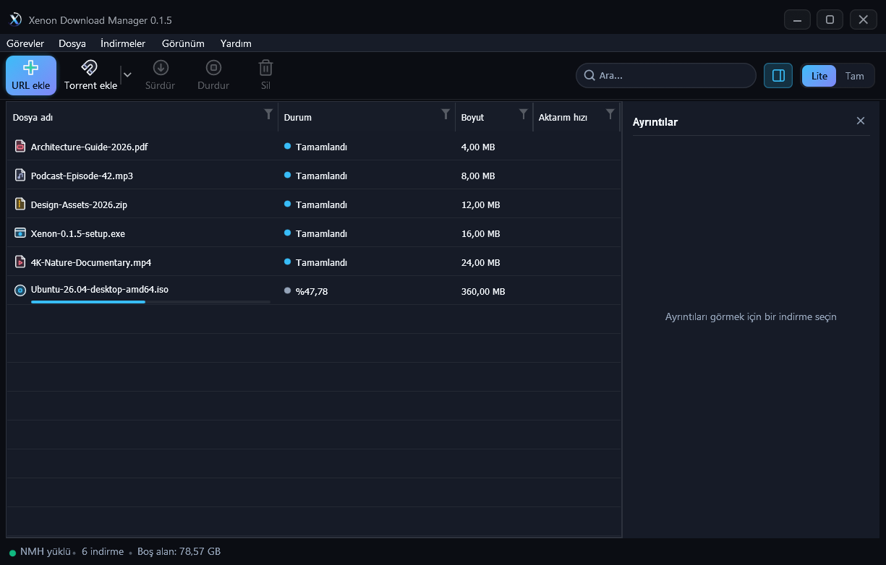<br />
      <sub>Sade araç çubuğu, odaklı 4 sütunlu liste, ayrı pencere boyutu ve isteğe bağlı Ayrıntılar paneli</sub>
    </td>
    <td width="50%" align="center">
      <b>☀️ Xenon Nexus Açık Tema</b><br /><br />
      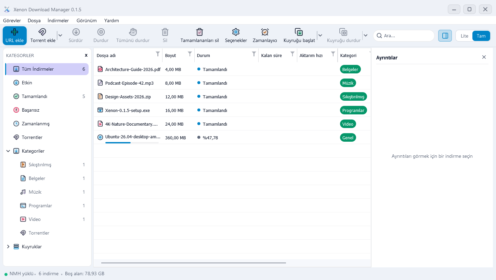<br />
      <sub>Temiz açık palet, derin gökyüzü ve çivit vurguları, canlı kategori etiketleri</sub>
    </td>
  </tr>
  <tr>
    <td width="50%" align="center">
      <b>⚡ Çoklu Bağlantı Canlı İlerleme</b><br /><br />
      <br />
      <sub>8 paralel bağlantı parçası, gerçek zamanlı hız ve otomatik tek/çoklu bağlantı uyumu</sub>
    </td>
    <td width="50%" align="center">
      <b>🎨 11 Modern Tema Geçişi</b><br /><br />
      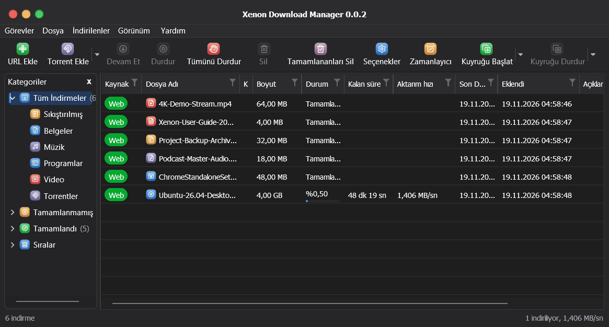<br />
      <sub><b>Xenon Nexus</b> · macOS · Obsidian Carbon · Midnight Blue · Emerald Teal · Royal Amethyst · Nord Frost ve daha fazlası</sub>
    </td>
  </tr>
  <tr>
    <td width="50%" align="center">
      <b>🍏 macOS Koyu Tema</b><br /><br />
      <br />
      <sub>Yuvarlak pencere düğmeleri, macOS kenar çubuğu ve squircle simgeler</sub>
    </td>
    <td width="50%" align="center">
      <b>🤍 macOS Açık Tema</b><br /><br />
      <br />
      <sub>Gümüş-gri üst çubuk, yumuşak açık yüzeyler ve Apple Blue vurguları</sub>
    </td>
  </tr>
  <tr>
    <td width="50%" align="center">
      <b>🍪 Yedek <code>cookies.txt</code> &amp; Site Oturumları</b><br /><br />
      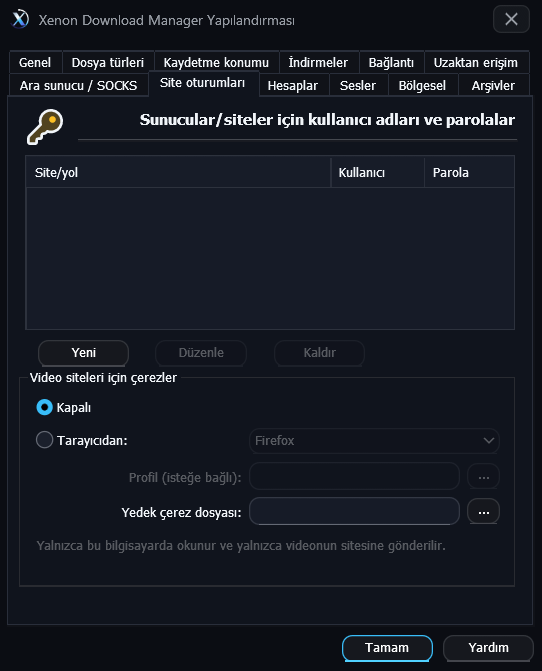<br />
      <sub>Okul/MEB veya ortak ağlarda bot doğrulamasında otomatik devreye giren yerel yedek çerez desteği</sub>
    </td>
    <td width="50%" align="center">
      <b>📂 388+ Uzantı &amp; Anlık Senkronizasyon</b><br /><br />
      <br />
      <sub>Eklenen uzantı anında yakalanır, silinen uzantı tarayıcıya geri devredilir</sub>
    </td>
  </tr>
  <tr>
    <td width="50%" align="center">
      <b>🧩 Tarayıcı Uzantısı Kılavuzu</b><br /><br />
      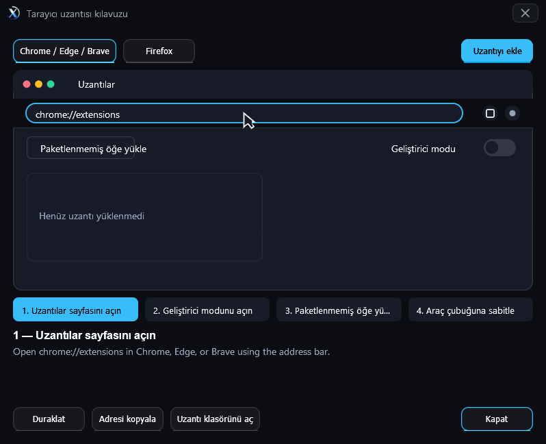<br />
      <sub>Chrome, Edge, Brave, Opera, Vivaldi ve Firefox için 4 adımlı etkileşimli kurulum rehberi</sub>
    </td>
    <td width="50%" align="center">
      <b>🔄 Hakkında &amp; Uygulama İçi Güncelleme</b><br /><br />
      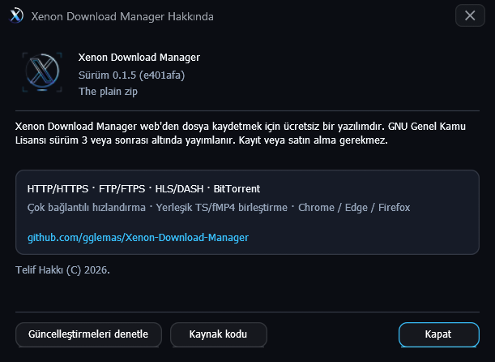<br />
      <sub>GitHub Releases üzerinden SHA-256 doğrulamalı tek tıkla güncelleme ve otomatik yeniden başlatma</sub>
    </td>
  </tr>
</table>

<details>
  <summary><b>🖤 Obsidian Carbon Görünümünü Aç</b></summary>
  <br />
  <div align="center">
    
    <br />
    <sub><b>Obsidian Carbon</b> — Yüksek kontrastlı saf karbon koyu tema</sub>
  </div>
</details>

---

### Uygulama Hakkında

**Xenon Download Manager**, Windows (64-bit) için Rust ile geliştirilmiş hızlı, hafif ve ücretsiz bir indirme yöneticisidir. Kayıt, reklam veya abonelik gerektirmez.

#### Öne Çıkan Özellikler
- **Lite / Tam Görünüm & Modern Tasarım:** `Ctrl+Shift+L`, *Görünüm* menüsü veya araç çubuğundaki **Lite | Tam** anahtarıyla sade ve tam görünüm arasında anında geçiş; sürüklenebilir *Ayrıntılar* paneli, dar pencerede akıllı araç çubuğu taşma (`...`) menüsü, *Görünüm → Yoğunluk* (**Otomatik / Ferah / Kompakt**) ve **11 modern tema** (**Xenon Nexus**, **macOS**, **Obsidian Carbon**, **Midnight Blue**, **Emerald Teal**, **Royal Amethyst**, **Amber Bronze**, **Nord Frost**, **Sakura Rose**, **Cobalt Steel**, **Arctic Slate**).
- **Çoklu Bağlantı & Akıllı Adres Yenileme:** Dosyaları paralel parçalara bölerek hızlandırır, tek bağlantılı sunuculara otomatik uyum sağlar. Süresi dolan indirme linklerinde *İndirme adresini yenile* penceresi açıkken tarayıcıdan aynı dosya tetiklendiğinde taze link/çerez/Referer otomatik aktarılır ve indirme kaldığı yerden sürdürülür.
- **Gömülü `quickjs-ng v0.18.0` ile Sıfır Kurulum YouTube & Video Yakalama:** Harici `deno.exe` veya `node` kurulumu gerektirmeden YouTube JS imza/challenge akışlarını doğrudan `xdm.exe` içinde çözer. Yerleşik **HLS (`.m3u8`)**, **DASH (`.mpd`)**, **MP4**, **TS**, **FLV**, **M4A**, **WEBM/Opus** akış indirme, 3 parçalı `HEAD` ile gerçekçi VBR HLS boyut tahmini ve yerleşik LGPL FFmpeg birleştirme sunar.
- **Okul / Kurumsal (MEB) Ağı & Yedek `cookies.txt` Kurtarma:** Sistem kök sertifikası doğrulamalı TLS kurtarma ve *Seçenekler → Site oturumları → Yedek çerez dosyası* desteğiyle yalnızca indirme bot doğrulaması/yetki hatasıyla engellendiğinde yerel çerez dosyasını otomatik devreye alır *(kendi `cookies.txt` dosyanızı yerelde oluşturmak için [Get cookies.txt LOCALLY](https://chromewebstore.google.com/detail/get-cookiestxt-locally/cclelndahbckbenkjhflpdbgdldlbecc) uzantısını kullanabilirsiniz)*.
- **Zengin Araçlar & Yerel Windows Deneyimi:** Zamanlayıcı ve kuyruk yönetimi, indirme başına hız sınırlayıcı, toplu indirme, arşiv ayıklama, BitTorrent, komut satırı aracı (`xdm-cli`), saydam yüksek çözünürlüklü simgeler, gömülü 4 özgün `.wav` bildirim sesi ve yerel Windows `ShellExecute` / `SHOpenWithDialog` (*Birlikte aç*) desteği.

---

### Windows Kurulumu (Windows 10 / 11 — 64-bit)

[Releases](https://github.com/gglemas/Xenon-Download-Manager/releases/latest) sayfasından ihtiyacınıza uygun paketi indirin:

| Paket | Açıklama |
|---|---|
| `Xenon-<sürüm>-setup.exe` | **Önerilen kurulum sihirbazı.** Uygulamayı, yerleşik FFmpeg'i ve tarayıcı iletişim köprüsünü tek seferde kurar. |
| `Xdm-<sürüm>-x64.zip` | **Standart ZIP paketi.** İstediğiniz bir klasöre çıkarıp `xdm.exe` dosyasını çalıştırın. Ayarlar `%APPDATA%` içinde saklanır. |
| `Xdm-<sürüm>-portable.zip` | **Taşınabilir (Portable) paket.** İçindeki `data` klasörü sayesinde tüm ayarlar ve indirme listesi uygulamanın yanında tutulur; kayıt defterine yazmaz. |
| `mdm-chromium.zip` / `mdm-firefox.xpi` | Yalnızca tarayıcı uzantısını ayrıca indirmek isteyenler için ek paketler *(ana Windows paketlerinin içinde `extension/` klasöründe de bulunur)*. |

---

### Tarayıcı Uzantısı Nasıl Kurulur?

#### 1. Masaüstü Köprüsünü Etkinleştirme
1. `Xenon-<sürüm>-setup.exe` kurulumu tarayıcı köprüsünü otomatik kaydeder.
2. ZIP veya taşınabilir pakette `xdm.exe` dosyasını çalıştırın; manuel kayıt gerekirse program klasöründe şu komutu çalıştırabilirsiniz:
   ```powershell
   .\xdm-nmhost.exe --register
   ```
   > **İpucu:** Uygulama içinde **Yardım → Tarayıcı uzantısı kılavuzu** penceresindeki **"Uzantı klasörünü aç"** düğmesi doğrudan `extension` klasörünü açar.

#### 2. Google Chrome / Microsoft Edge / Brave / Opera / Vivaldi
1. Adres çubuğuna tarayıcınızın uzantılar sayfasını yazın: `chrome://extensions`, `edge://extensions`, `brave://extensions`, `opera://extensions` veya `vivaldi://extensions`.
2. Sağ üstten **Geliştirici modu (Developer mode)** anahtarını açın.
3. **Paketlenmemiş öğe yükle (Load unpacked)** düğmesine tıklayıp `xdm.exe` yanındaki **`extension\chromium`** klasörünü seçin.
4. Araç çubuğundaki **Uzantılar (yapboz)** simgesinden **Xenon Download Manager** uzantısını sabitleyin.

#### 3. Mozilla Firefox
1. Adres çubuğuna `about:debugging#/runtime/this-firefox` yazın.
2. **Geçici Eklenti Yükle... (Load Temporary Add-on...)** düğmesine tıklayıp **`extension\mdm-firefox.xpi`** dosyasını seçin.

#### 4. Kullanım İpuçları
- **Geçici olarak tarayıcıyla indirme:** Bağlantıya **`Alt` + tıklayın**.
- **Video yakalama düğmesi:** Desteklenen oynatıcıların üzerinde görünen **Xenon** düğmesinden 8K'ya kadar çözünürlük, ses (`M4A` / `WEBM-Opus`) ve kapsayıcı (`MP4` / `TS` / `MKV` / `FLV` / `MOV`) seçebilirsiniz.
- **Canlı uzantı senkronizasyonu:** *Seçenekler → Dosya türleri* listesinde yapılan değişiklikler tarayıcı uzantısına anında yansır.

---

### Komut Satırı (`xdm-cli`)

```powershell
# Doğrudan dosya, HLS (.m3u8) veya DASH (.mpd) indirme
.\xdm-cli.exe get "https://example.com/file.zip" -o ".\indirilenler"

# Video / DASH akışını belirli kapsayıcıda indirme (.mp4, .ts, .flv)
.\xdm-cli.exe get "https://example.com/stream/manifest.mpd" -o ".\video.mp4"
```

---

### Paylaşım Politikası ve Lisans

- Bu genel depoda yalnızca **Windows uyumlu derlenmiş sürümler (Releases)** ve dokümantasyon paylaşılmaktadır.
- **Lisans:** GNU General Public License v3.0 or later (`LICENSE`). Yerleşik `quickjs-ng`, FFmpeg (LGPL), simge setleri ve yerel coğrafi veri bileşenleri kendi açık lisanslarına (MIT, ISC, LGPL-2.1/3.0, CC BY 4.0) tabidir.

---

## 🇬🇧 English

### 🎬 Live Showcase — English Interface (`v0.1.5`)

<div align="center">
  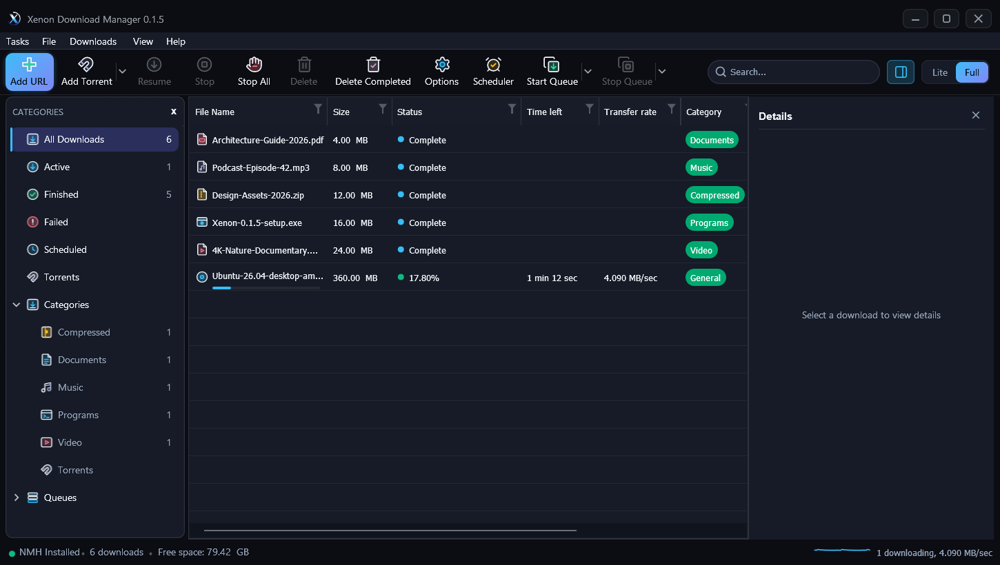
  <br />
  <sub><b>Xenon Nexus Dark (Full View)</b> — Gradient <i>Add URL</i> button, <b>Lite | Full</b> switch, modern category sidebar, live multi-connection progress, and resizable <i>Details</i> pane</sub>
</div>

<br />

<table>
  <tr>
    <td width="50%" align="center">
      <b>✨ Lite View (<code>Ctrl+Shift+L</code>)</b><br /><br />
      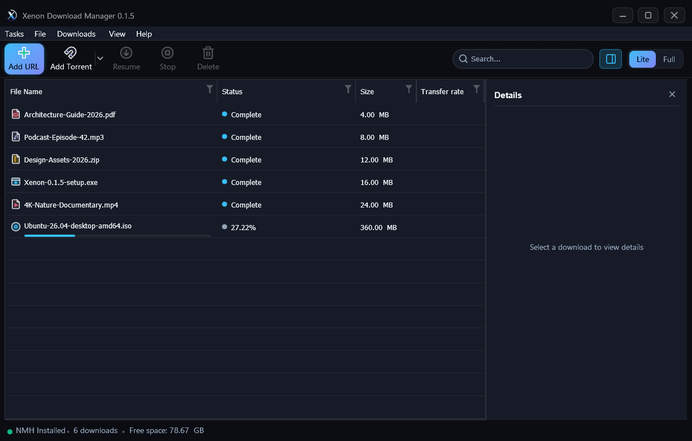<br />
      <sub>Streamlined toolbar, focused 4-column list, independent saved window geometry, and optional Details pane</sub>
    </td>
    <td width="50%" align="center">
      <b>☀️ Xenon Nexus Light</b><br /><br />
      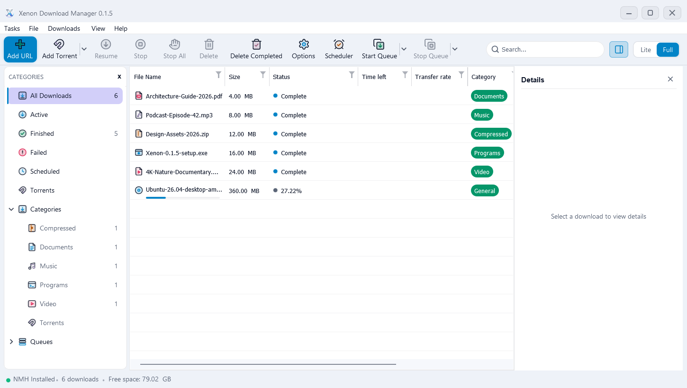<br />
      <sub>Crisp cool-paper light surfaces with deep sky and indigo accents</sub>
    </td>
  </tr>
  <tr>
    <td width="50%" align="center">
      <b>🍪 Fallback <code>cookies.txt</code> &amp; Sites Logins</b><br /><br />
      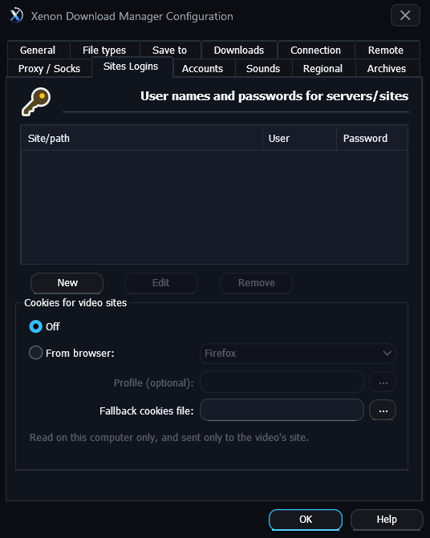<br />
      <sub>Optional local Netscape <code>cookies.txt</code> used automatically only when a download hits a bot check or auth block</sub>
    </td>
    <td width="50%" align="center">
      <b>🧩 Browser Extension Guide</b><br /><br />
      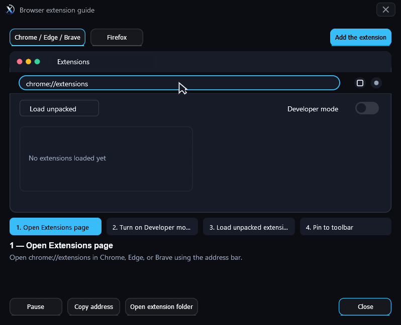<br />
      <sub>Built-in 4-step interactive setup guide for Chromium-based browsers and Firefox</sub>
    </td>
  </tr>
  <tr>
    <td width="50%" align="center">
      <b>🔄 About &amp; In-App Self-Updater</b><br /><br />
      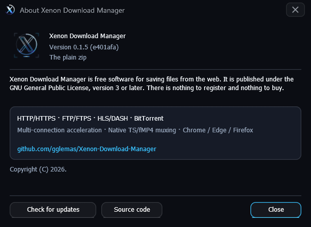<br />
      <sub>Checks GitHub Releases, verifies <code>SHA256SUMS.txt</code>, installs, and restarts automatically</sub>
    </td>
    <td width="50%" align="center">
      <b>🎨 11 Modern Themes Showcase</b><br /><br />
      <br />
      <sub><b>Xenon Nexus</b> · macOS Dark/Light · Obsidian Carbon · Midnight Blue · Emerald Teal · Royal Amethyst · Nord Frost &amp; more</sub>
    </td>
  </tr>
</table>

---

### About Xenon Download Manager

**Xenon Download Manager** is a fast, lightweight, free download manager for **Windows (64-bit)** written in Rust. No registration, ads, or subscription required.

#### Key Features
- **Lite / Full View & Modern UI:** Switch instantly between Lite and Full modes via `Ctrl+Shift+L`, *View*, or the toolbar **Lite | Full** toggle. Includes a draggable *Details* pane, responsive toolbar overflow (`...`) on narrow windows, *View → Density* (**Auto / Comfortable / Compact**), transparent `16–256 px` icons, 4 original embedded `.wav` notification sounds, and **11 built-in themes**.
- **Multi-Connection Acceleration & Seamless Address Refresh:** Splits downloads into parallel connections and adapts automatically to single-connection servers. When refreshing an expired link, re-triggering the download in your browser automatically updates the URL, cookies, and `Referer` on the existing task so it resumes cleanly.
- **Embedded `quickjs-ng v0.18.0` for Zero-Setup YouTube & Stream Capture:** Solves YouTube JS challenges natively inside `xdm.exe` with no external `deno.exe` or `node` runtime required. Supports native **HLS (`.m3u8`)**, **DASH (`.mpd`)**, **MP4**, **TS**, **MKV**, **FLV**, **M4A**, and **WEBM/Opus**, realistic 3-segment `HEAD` VBR HLS size estimation, and bundled LGPL FFmpeg muxing.
- **Enterprise / School Network TLS & Fallback `cookies.txt` Recovery:** Verifies enterprise/school SSL roots against the Windows Trusted Root Store and supports an optional local *Fallback cookies file* under *Options → Sites Logins* (you can export your own Netscape `cookies.txt` locally with [Get cookies.txt LOCALLY](https://chromewebstore.google.com/detail/get-cookiestxt-locally/cclelndahbckbenkjhflpdbgdldlbecc)) alongside automatic recovery from Windows Chrome cookie locks.
- **Complete Toolkit:** Queues & scheduler, per-download and global speed limiter, batch downloads, archive extraction, BitTorrent, CLI tool (`xdm-cli`), and native Windows `ShellExecute` / `SHOpenWithDialog` (*Open with*) integration.

---

### Windows Setup (Windows 10 / 11 — 64-bit)

Download the package that fits your workflow from [Releases](https://github.com/gglemas/Xenon-Download-Manager/releases/latest):

| Package | Description |
|---|---|
| `Xenon-<version>-setup.exe` | **Recommended Windows installer.** Installs the desktop app, bundled LGPL FFmpeg, and browser native messaging host automatically. |
| `Xdm-<version>-x64.zip` | **Standard ZIP build.** Extract to a permanent folder and run `xdm.exe`. Settings are stored in `%APPDATA%`. |
| `Xdm-<version>-portable.zip` | **Portable build.** Includes a `data` folder so all settings and downloads stay next to `xdm.exe` with zero registry writes. |
| `mdm-chromium.zip` / `mdm-firefox.xpi` | Standalone browser extension packages *(also bundled inside the main Windows packages under `extension/`)*. |

---

### Browser Extension Installation Guide

1. **Native Messaging Host:** Installed automatically by `Xenon-<version>-setup.exe`. For portable folders, run `.\xdm-nmhost.exe --register` from the program folder.
2. **Chrome / Edge / Brave / Opera / Vivaldi:** Open `chrome://extensions` (or your browser's extensions page), enable **Developer mode**, click **Load unpacked**, select the **`extension\chromium`** folder next to `xdm.exe`, and pin **Xenon Download Manager**.
3. **Mozilla Firefox:** Open `about:debugging#/runtime/this-firefox`, click **Load Temporary Add-on...**, and select **`extension\mdm-firefox.xpi`**.
4. **Everyday tips:** Hold **`Alt` + click** to let the browser handle a single download; use the floating **Xenon** video button on media players for up to 8K quality, audio tracks, and container selection.

---

### Command Line (`xdm-cli`)

```powershell
# Download a file, HLS (.m3u8), or DASH (.mpd) stream
.\xdm-cli.exe get "https://example.com/file.zip" -o ".\downloads"

# Download a video / DASH stream into a specific container (.mp4, .ts, .flv)
.\xdm-cli.exe get "https://example.com/stream/manifest.mpd" -o ".\video.mp4"
```

---

### Release Policy & License

- This public repository publishes **Windows binaries (Releases)** and documentation only.
- **License:** GNU General Public License v3.0 or later (`LICENSE`). Embedded `quickjs-ng`, bundled LGPL FFmpeg, icon themes, and local GeoIP databases remain under their respective open licenses (MIT, ISC, LGPL-2.1/3.0, CC BY 4.0).

---

<div align="center">

### ✨ Geliştirme İmzası / Co-Development Signature

<a href="https://deepmind.google/technologies/gemini/">
  
</a>


<br />

<sub>
  <b>gglemas</b> &amp; <b>Google Gemini (Antigravity)</b> tarafından birlikte tasarlandı, test edildi ve cilalandı.<br />
  <i>Architected, engineered, stress-tested, and polished together by <b>gglemas</b> &amp; <b>Google Gemini (Antigravity)</b> — Xenon Nexus Edition.</i>
</sub>

</div>
