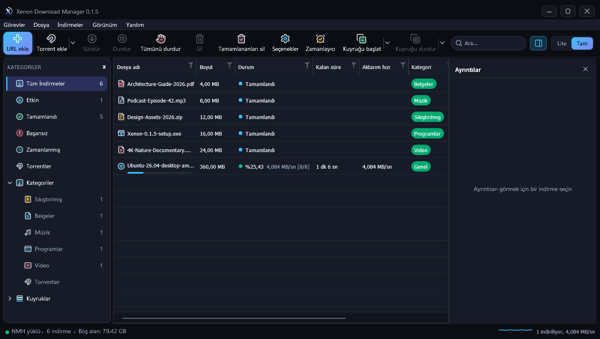
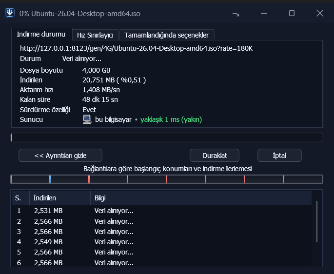
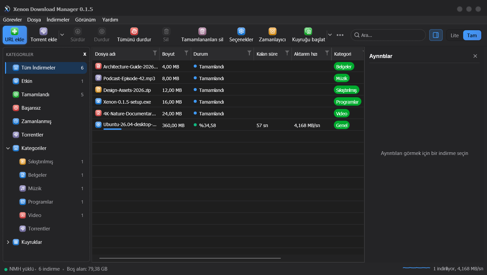
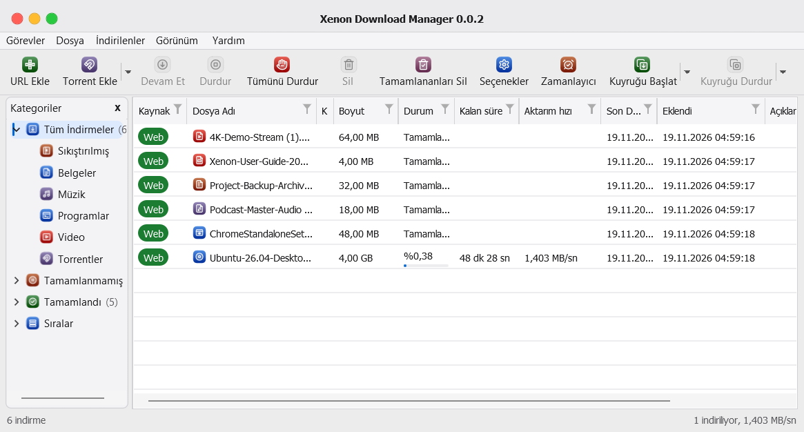
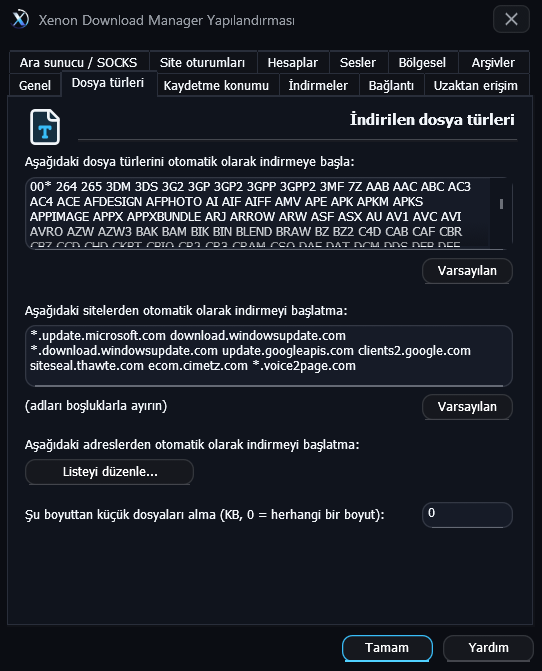
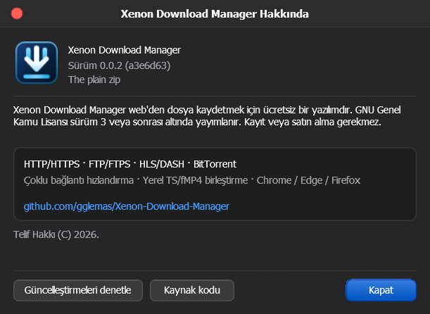
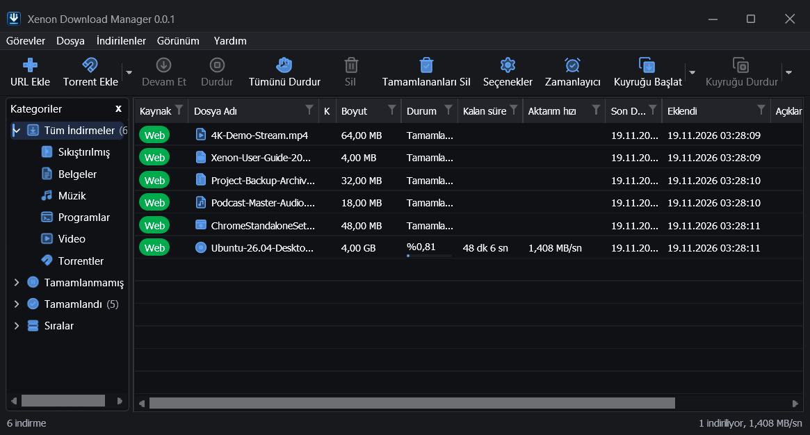
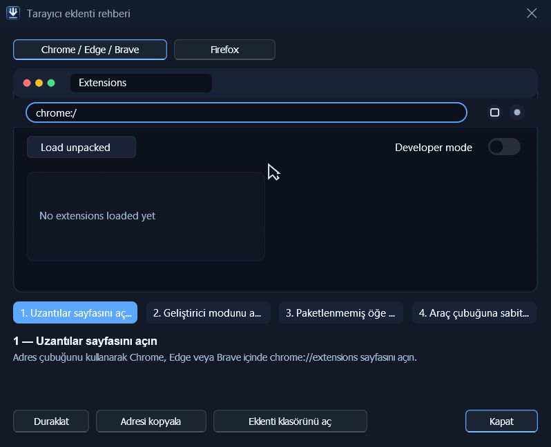

<div align="center">


# Xenon Download Manager

**Windows (64-bit) için Rust ile geliştirilmiş yeni nesil, hızlı ve ücretsiz indirme yöneticisi**
*Next-generation, ultra-fast, free download manager built with Rust for Windows (64-bit)*

<p>
  <a href="https://github.com/gglemas/Xenon-Download-Manager/releases/latest">
    
  </a>
  
  
  
</p>

<p>
  <a href="https://deepmind.google/technologies/gemini/">
    
  </a>
  
</p>

**[🇹🇷 Türkçe](#-türkçe)** · **[🇬🇧 English](#-english)** · **[🎬 Canlı Görünüm / Showcase](#-canlı-görünüm--live-showcase)** · **[🧩 Eklenti Kurulumu](#-tarayıcı-eklentisi-nasıl-kurulur)** · **[⬇️ Windows İndir / Download](https://github.com/gglemas/Xenon-Download-Manager/releases/latest)**

</div>

---

## 🎬 Canlı Görünüm / Live Showcase

<div align="center">
  
  <br />
  <sub><b>Ana Pencere (Midnight Blue)</b> — Çoklu kategori filtresi, canlı hız grafiği ve modern karanlık arayüz</sub>
</div>

<br />

<table>
  <tr>
    <td width="50%" align="center">
      <b>⚡ Çoklu Bağlantı Canlı İlerleme / Live Multi-Connection</b><br /><br />
      <br />
      <sub>Paralel bağlantı çubukları, gerçek zamanlı hız ve otomatik tek/çoklu bağlantı sunucu uyumu</sub>
    </td>
    <td width="50%" align="center">
      <b>🎨 7 Modern Tema Geçişi / Live Theme Switcher</b><br /><br />
      <br />
      <sub><b>macOS</b> · Midnight Blue · <b>Obsidian Carbon</b> · Emerald Teal · Royal Amethyst · Amber Bronze · Nord Frost</sub>
    </td>
  </tr>
  <tr>
    <td width="50%" align="center">
      <b>🍏 macOS Dark &amp; Trafik Işıkları / macOS Sequoia Dark</b><br /><br />
      <br />
      <sub>Sol trafik ışığı butonları, ortalanmış başlık, squircle ikonlar ve Apple Blue kontroller</sub>
    </td>
    <td width="50%" align="center">
      <b>☀️ macOS Light / macOS Sonoma Light</b><br /><br />
      <br />
      <sub>Gümüş-gri macOS üst çubuk, Finder kenar çubuğu ve canlı squircle vektör simgeler</sub>
    </td>
  </tr>
  <tr>
    <td width="50%" align="center">
      <b>📂 388+ Uzantı &amp; Anlık Eklenti Senkronizasyonu</b><br /><br />
      <br />
      <sub>Eklenen uzantı anında yakalanır, silinen uzantı tarayıcıya geri devredilir</sub>
    </td>
    <td width="50%" align="center">
      <b>🔄 Hakkında &amp; Uygulama İçi Güncelleme</b><br /><br />
      <br />
      <sub>GitHub Releases üzerinden doğrudan uygulama içi indir, kur ve yeniden başlat</sub>
    </td>
  </tr>
</table>

<details>
  <summary><b>🖤 Obsidian Carbon Özel Görünümünü Aç / View Obsidian Carbon Edition</b></summary>
  <br />
  <div align="center">
    
    <br />
    <sub><b>Obsidian Carbon</b> — Yüksek kontrastlı saf karbon koyu tema</sub>
  </div>
</details>

---

## 🇹🇷 Türkçe

### Uygulama Hakkında

**Xenon Download Manager**, Windows (64-bit) için Rust ile geliştirilmiş hızlı, hafif ve ücretsiz bir indirme yöneticisidir. Kayıt, reklam veya abonelik gerektirmez.

#### Öne Çıkan Özellikler
- **Çoklu Bağlantı & Otomatik Sunucu Uyumu:** Dosyaları paralel parçalara bölerek hızlandırır; tek bağlantıya izin veren sunuculara otomatik uyum sağlar. Duraklatma, devam ettirme ve indirme sürerken kaydetme klasörünü canlı değiştirme desteği sunar.
- **Video & Medya Akışı Yakalama:** Yerleşik **HLS (`.m3u8`)**, **DASH (`.mpd`)**, **MP4**, **TS**, **FLV**, **M4A** ve **WEBM/Opus** akış indirme ve yerel FFmpeg birleştirme (`avc1 + mp4a` uyumlu akışlarda yeniden kodlama yapmadan kayıpsız birleştirme).
- **Esnek Dosya Türü & İstisna Yönetimi:** Video, ses, arşiv ve yürütülebilir dosyalar dâhil **388+ uzantı** varsayılan olarak tanımlıdır. *Seçenekler → Dosya türleri* ekranında eklediğiniz yeni uzantılar anında yakalanır, sildiğiniz uzantılar tarayıcıya geri devredilir.
- **Akıllı Yönlendirme & Güvenlik:** Ara indirme sayfalarını ve yönlendirmeleri otomatik çözer; geçersiz/süresi dolmuş TLS sertifikalarında beklemeden anında uyarı verir.
- **Zengin Araçlar:** Zamanlayıcı ve kuyruk yönetimi, toplu indirme, arşiv açma, BitTorrent, komut satırı aracı (`xdm-cli`) ve **10 modern tema** (**macOS Dark/Light**, **Midnight Blue**, **Obsidian Carbon**, **Emerald Teal**, **Royal Amethyst**, **Amber Bronze**, **Nord Frost**, **Sakura Rose**, **Cobalt Steel**, **Arctic Slate**).
- **Uygulama İçi Güncelleme:** *Yardım → Güncelleştirmeleri denetle* üzerinden yeni Windows sürümlerini doğrudan GitHub Releases'tan indirir, `SHA256SUMS.txt` ile doğrular, kurar ve uygulamayı otomatik yeniden başlatır.

---

### Windows Kurulumu (Windows 10 / 11 — 64-bit)

Şimdilik yalnızca **Windows 64-bit (x64)** sürümleri yayımlanmaktadır. [Releases](https://github.com/gglemas/Xenon-Download-Manager/releases/latest) sayfasından ihtiyacınıza uygun paketi indirin:

| Paket | Açıklama |
|---|---|
| `Xdm-<sürüm>-x64.zip` | **Standart paket.** İstediğiniz bir klasöre çıkarıp `xdm.exe` dosyasını çalıştırın. Ayarlar ve indirme listesi `%APPDATA%` içinde saklanır. |
| `Xdm-<sürüm>-portable.zip` | **Taşınabilir (Portable) paket.** İçindeki `data` klasörü sayesinde tüm ayarlar ve indirme listesi uygulamanın yanında tutulur; kayıt defterine yazmaz. |
| `mdm-chromium.zip` / `mdm-firefox.xpi` | Yalnızca tarayıcı eklentisini ayrıca indirmek isteyenler için ek eklenti paketleri *(ana Windows ZIP arşivlerinin içinde `extension/` klasöründe de hazır olarak bulunur)*. |

**Paket İçeriği:**
- `xdm.exe` — Masaüstü uygulaması
- `xdm-nmhost.exe` — Tarayıcı eklentisi iletişim köprüsü (Native Messaging Host)
- `xdm-cli.exe` — Komut satırı indiricisi
- `xdm-mcp.exe` — MCP entegrasyon köprüsü
- `extension/chromium/` — Chrome, Edge, Brave, Opera ve Vivaldi eklenti klasörü
- `extension/firefox/` ve `extension/mdm-firefox.xpi` — Firefox eklenti dosyaları

---

### Tarayıcı Eklentisi Nasıl Kurulur?

<div align="center">
  
  <br />
  <sub><b>4 Adımda Canlı Kurulum Rehberi</b> — Uygulama içindeki <i>Yardım → Tarayıcı eklenti rehberi</i> animasyonundan alınmıştır</sub>
</div>

<br />

#### 1. Masaüstü Köprüsünü Etkinleştirme
1. İndirdiğiniz ZIP arşivini kalıcı bir klasöre çıkarın (ör. `C:\Apps\Xenon Download Manager\`).
2. `xdm.exe` dosyasını çalıştırın.
3. Standart kurulumda (`x64.zip`) tarayıcı köprüsü otomatik kaydedilir. Taşınabilir kullanım veya manuel kayıt için program klasöründe bir terminal açıp şu komutu çalıştırabilirsiniz:
   ```powershell
   .\xdm-nmhost.exe --register
   ```
   > **İpucu:** Uygulama içinde **Yardım → Tarayıcı eklenti rehberi** penceresindeki **"Eklenti klasörünü aç"** düğmesi doğrudan `xdm.exe` kök dizinini açar; buradan `extension` klasörüne tek tıkla ulaşabilirsiniz.

#### 2. Google Chrome / Microsoft Edge / Brave / Opera / Vivaldi Kurulumu
1. Tarayıcınızın adres çubuğuna ilgili adresi yazıp **Enter** tuşuna basın:
   - **Chrome:** `chrome://extensions`
   - **Edge:** `edge://extensions`
   - **Brave:** `brave://extensions`
   - **Opera:** `opera://extensions`
   - **Vivaldi:** `vivaldi://extensions`
2. Sağ üst köşedeki **Geliştirici modu (Developer mode)** anahtarını **Açık** konuma getirin.
3. Sol üstteki **Paketlenmemiş öğe yükle (Load unpacked)** düğmesine tıklayın.
4. Açılan klasör penceresinde `xdm.exe` yanında bulunan **`extension\chromium`** klasörünü seçin ve **Klasör Seç**'e tıklayın.
5. Tarayıcı araç çubuğundaki **Uzantılar (yapboz)** simgesine tıklayın ve **Xenon Download Manager** eklentisini sabitleyin.

#### 3. Mozilla Firefox Kurulumu
1. Firefox adres çubuğuna `about:debugging#/runtime/this-firefox` yazıp **Enter** tuşuna basın.
2. **Geçici Eklenti Yükle... (Load Temporary Add-on...)** düğmesine tıklayın.
3. `xdm.exe` yanındaki **`extension\firefox\manifest.json`** (veya `extension\mdm-firefox.xpi`) dosyasını seçip **Aç**'a tıklayın.
4. Eklenti anında etkinleşir. *(Not: Firefox imzasız eklentileri oturum süresince tutar; tarayıcı yeniden başlatıldığında aynı adımla tekrar yüklenebilir.)*

#### 4. Kullanım İpuçları
- **Tarayıcıyla İndirme (Geçici Devre Dışı):** Bir bağlantıyı Xenon yerine doğrudan tarayıcıyla indirmek için bağlantıya **`Alt` + tıklayın**.
- **Video İndirme Düğmesi:** Desteklenen video oynatıcıların üzerinde görünen **Xenon** düğmesinden çözünürlük, ses (`M4A` / `WEBM-Opus`) ve kapsayıcı formatı (`MP4` / `TS` / `FLV` / `MOV`) seçebilirsiniz.
- **Canlı Uzantı Senkronizasyonu:** *Seçenekler → Dosya türleri* listesinde uzantı ekleyip sildiğinizde değişiklikler tarayıcı eklentisine anında yansır.
- **Bağlantı Sorunu Giderme:** Eklenti simgesi bağlı değil görünüyorsa `xdm.exe` uygulamasının açık olduğundan emin olun, program klasöründe `.\xdm-nmhost.exe --register` komutunu çalıştırıp tarayıcıyı yeniden başlatın.

---

### Komut Satırı (`xdm-cli`)

```powershell
# Doğrudan dosya, HLS (.m3u8) veya DASH (.mpd) indirme
.\xdm-cli.exe get "https://example.com/file.zip" -o ".\indirilenler"

# Video / DASH akışını belirli kapsayıcıda indirme (.mp4, .ts, .flv)
.\xdm-cli.exe get "https://example.com/stream/manifest.mpd" -o ".\video.mp4"
```

---

### Paylaşım Politikası ve Lisans

- Bu depoda şimdilik yalnızca **Windows uyumlu derlenmiş sürümler (Releases)** ve kullanım dokümantasyonu paylaşılmaktadır; çekirdek indirme motoru kaynak kodları bu aşamada depoya dâhil edilmemektedir.
- **Lisans:** GNU General Public License v3.0 or later (`LICENSE`). Simge setleri ve yerel coğrafi veri bileşenleri kendi açık lisanslarına (MIT, ISC, LGPL-3.0, CC BY 4.0) tabidir.

---

## 🇬🇧 English

### About Xenon Download Manager

**Xenon Download Manager** is a fast, lightweight, free download manager for **Windows (64-bit)** built with Rust. No registration, ads, or subscription required.

#### Key Features
- **Multi-Connection Acceleration & Auto-Adaptation:** Splits downloads into parallel segments and automatically adapts when a server only allows single connections. Supports pause/resume and changing the destination folder while a download is running.
- **Video & Stream Capture:** Native **HLS (`.m3u8`)**, **DASH (`.mpd`)**, **MP4**, **TS**, **FLV**, **M4A**, and **WEBM/Opus** downloading with local FFmpeg muxing (stream-copying compatible `avc1 + mp4a` tracks before falling back to re-encoding).
- **Dynamic File Types & Smart Exclusions:** Ships with **388+ extensions** covering video, audio, archives, documents, and installers. Adding or removing extensions in *Options → File types* syncs live with the browser extension; removed types immediately fall back to the browser.
- **Smart Redirect Handling & Security:** Resolves indirect download pages and meta-refreshes automatically, rejects HTML decoy responses for binary links, and fails fast on invalid/expired TLS certificates.
- **Built-in Tools:** Queue & scheduler, batch downloads, archive extraction, BitTorrent, CLI tool (`xdm-cli`), and **10 modern themes** (**macOS Dark/Light**, **Midnight Blue**, **Obsidian Carbon**, **Emerald Teal**, **Royal Amethyst**, **Amber Bronze**, **Nord Frost**, **Sakura Rose**, **Cobalt Steel**, **Arctic Slate**).
- **In-App Self-Updater:** *Help → Check for updates* checks GitHub Releases, verifies checksums (`SHA256SUMS.txt`), downloads inside the app with a progress bar, installs, and restarts automatically.

---

### Windows Setup (Windows 10 / 11 — 64-bit)

Currently only **Windows 64-bit (x64)** releases are published. Download the package you prefer from [Releases](https://github.com/gglemas/Xenon-Download-Manager/releases/latest):

| Package | Description |
|---|---|
| `Xdm-<version>-x64.zip` | **Standard build.** Extract to a permanent folder and run `xdm.exe`. Settings and download list are stored in `%APPDATA%`. |
| `Xdm-<version>-portable.zip` | **Portable build.** Includes a `data` folder so all settings and downloads stay next to `xdm.exe` with no registry writes. |
| `mdm-chromium.zip` / `mdm-firefox.xpi` | Standalone browser extension bundles *(also included inside the main Windows ZIP packages under `extension/`)*. |

**Package Contents:**
- `xdm.exe` — Desktop application
- `xdm-nmhost.exe` — Native Messaging Host bridge for browser integration
- `xdm-cli.exe` — Command-line downloader
- `xdm-mcp.exe` — MCP integration bridge
- `extension/chromium/` — Unpacked extension for Chrome, Edge, Brave, Opera, and Vivaldi
- `extension/firefox/` & `extension/mdm-firefox.xpi` — Firefox extension files

---

### Browser Extension Installation Guide

<div align="center">
  
  <br />
  <sub><b>4-Step Interactive Guide</b> — Recorded live from <i>Help → Browser extension guide</i> inside Xenon Download Manager</sub>
</div>

<br />

#### 1. Register the Native Messaging Host
1. Extract the Windows ZIP archive into a permanent folder (e.g., `C:\Apps\Xenon Download Manager\`).
2. Launch `xdm.exe`.
3. For standard builds (`x64.zip`), the native messaging host registers automatically. For portable folders or manual re-registration, run the following command inside the application folder:
   ```powershell
   .\xdm-nmhost.exe --register
   ```
   > **Tip:** Inside the app, open **Help → Browser extension guide** and click **"Open extension folder"** to open the root directory containing `xdm.exe` and the `extension/` folder directly.

#### 2. Google Chrome / Microsoft Edge / Brave / Opera / Vivaldi
1. Open the extensions page in your browser's address bar:
   - **Chrome:** `chrome://extensions`
   - **Edge:** `edge://extensions`
   - **Brave:** `brave://extensions`
   - **Opera:** `opera://extensions`
   - **Vivaldi:** `vivaldi://extensions`
2. Enable **Developer mode** using the toggle in the top-right corner.
3. Click **Load unpacked** in the top-left corner.
4. Select the **`extension\chromium`** folder located next to `xdm.exe` and click **Select Folder**.
5. Click the browser toolbar **Extensions (puzzle)** icon and pin **Xenon Download Manager**.

#### 3. Mozilla Firefox
1. Open `about:debugging#/runtime/this-firefox` in the Firefox address bar.
2. Click **Load Temporary Add-on...**.
3. Browse to **`extension\firefox\manifest.json`** (or `extension\mdm-firefox.xpi`) next to `xdm.exe` and click **Open**.
4. The extension activates immediately. *(Note: Firefox keeps unsigned temporary add-ons for the current browser session; reload it with the same step after restarting Firefox.)*

#### 4. Everyday Usage & Troubleshooting
- **Let the browser handle a single click:** Hold **`Alt` + click** any link to bypass Xenon Download Manager.
- **Video capture button:** Click the floating **Xenon** button on video players to pick resolution, audio track (`M4A` / `WEBM Opus`), or container (`MP4`, `TS`, `FLV`, `MOV`).
- **Instant File Types sync:** Any extension you add or delete under *Options → File types* syncs immediately to the browser extension.
- **Extension shows disconnected:** Make sure `xdm.exe` is running, run `.\xdm-nmhost.exe --register` from the program directory, and restart the browser.

---

### Command Line (`xdm-cli`)

```powershell
# Download a file, HLS (.m3u8), or DASH (.mpd) stream
.\xdm-cli.exe get "https://example.com/file.zip" -o ".\downloads"

# Download a video / DASH stream into a specific container (.mp4, .ts, .flv)
.\xdm-cli.exe get "https://example.com/stream/manifest.mpd" -o ".\video.mp4"
```

---

### Release Policy & License

- At this stage, this repository publishes **Windows binaries (Releases)** and documentation only; the core download engine source code is not included in the public repository yet.
- **License:** GNU General Public License v3.0 or later (`LICENSE`). Bundled icon themes and local GeoIP databases remain under their respective open licenses (MIT, ISC, LGPL-3.0, CC BY 4.0).

---

<div align="center">

### ✨ Geliştirme İmzası / Co-Development Signature

<a href="https://deepmind.google/technologies/gemini/">
  
</a>


<br />

<sub>
  <b>gglemas</b> &amp; <b>Google Gemini (Antigravity)</b> tarafından birlikte tasarlandı, test edildi ve cilalandı.<br />
  <i>Architected, engineered, stress-tested, and polished together by <b>gglemas</b> &amp; <b>Google Gemini (Antigravity)</b> — Carbon Edition.</i>
</sub>

</div>
